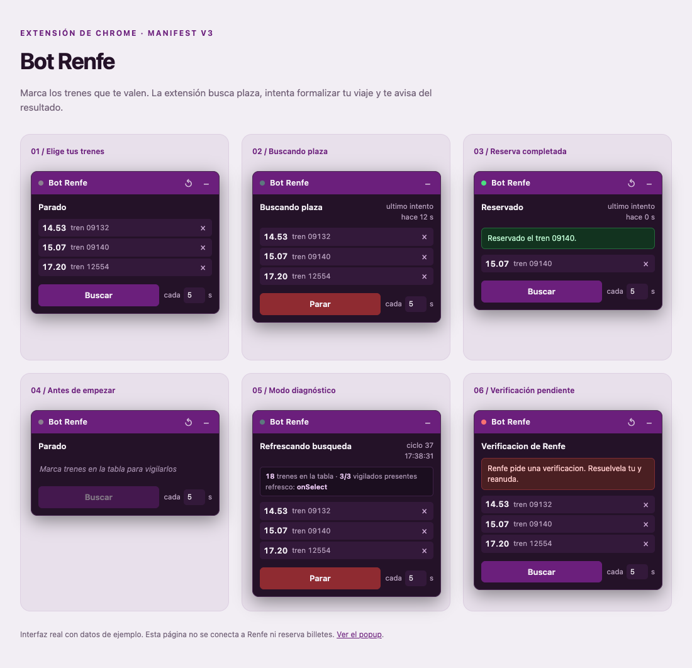
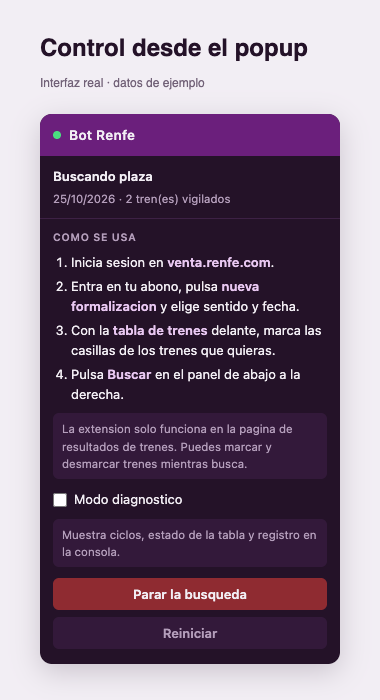

# Bot Renfe · extensión de Chrome

Vigila los trenes que elijas en tu abono de Renfe e intenta formalizar la reserva cuando aparece una plaza. Trabaja sobre la sesión que ya tienes abierta en Chrome.

**Manifest V3 · JavaScript sin compilación · Sin servidor propio**



*Captura de la interfaz real en la [vista previa local](dev/preview.html), con datos de ejemplo. El estado «Reservado» es una demostración visual.*

## Qué puedes hacer

- Marcar varios trenes de una misma fecha y sentido, incluso si están completos.
- Buscar plaza con un intervalo configurable entre 2 y 60 segundos.
- Cambiar los trenes vigilados mientras la búsqueda está en marcha.
- Recibir una notificación cuando se confirma una reserva o se pausa la búsqueda.
- Parar o reiniciar desde el popup, aunque tengas otra pestaña activa.
- Activar el modo diagnóstico para consultar ciclos, refrescos y errores.

Proyecto independiente, sin afiliación con Renfe. Adaptación a extensión del [bot de escritorio](https://github.com/jrrome/botRenfe).

## Instalación

No necesitas Node.js para usar la extensión.

1. Descarga este repositorio desde **Code → Download ZIP** y descomprímelo, o clónalo:

   ```bash
   git clone https://github.com/jrrome/extension-renfe.git
   ```

2. Guarda la carpeta en una ubicación definitiva.
3. Abre `chrome://extensions` y activa **Modo de desarrollador**.
4. Pulsa **Cargar descomprimida** y selecciona la carpeta que contiene `manifest.json`.
5. Fija el icono de Bot Renfe en la barra de extensiones si quieres tener el popup a mano.

Chrome sigue leyendo los archivos de esa carpeta: consérvala en su ubicación. Para actualizar, reemplaza los archivos y pulsa **Recargar** en la tarjeta de la extensión.

La [guía de instalación](INSTALL.md) incluye instrucciones para quien recibe el ZIP empaquetado.

## Uso

1. Inicia sesión en [venta.renfe.com](https://venta.renfe.com/).
2. Entra en tu abono, pulsa **Nueva formalización** y elige sentido y fecha.
3. En la tabla de trenes, marca las casillas de los viajes que te valgan.
4. Pulsa **Buscar** en el panel de abajo a la derecha.
5. Deja abierta esa pestaña. Cuando se confirme una reserva, revisa el resultado en Renfe.

La extensión puede pulsar tanto **Continuar** como la confirmación final. Si varios trenes vigilados tienen plaza, intenta reservar el primero que aparece en la tabla. Solo admite una búsqueda de fecha y sentido a la vez; usa una sola pestaña de formalización.

Si Renfe pide un captcha o una clave SMS visible, la búsqueda se pausa: resuelve la verificación y reanuda. El botón **↺** del panel y **Reiniciar** del popup borran la selección y conservan tus ajustes.



*Popup real con almacenamiento simulado para la captura.*

## Privacidad y permisos

No solicita ni almacena tu usuario o contraseña. Utiliza la sesión que tú abres en Renfe; no incorpora analítica ni servicios externos propios. Las acciones sobre los trenes sí se envían a Renfe mediante su página.

| Permiso | Para qué se utiliza |
| --- | --- |
| `storage` | Guardar selección, ajustes y estado en `chrome.storage.local`. |
| `notifications` | Avisar de una reserva o una pausa. |
| `alarms` | Comprobar si la búsqueda ha dejado de responder. |
| `https://venta.renfe.com/*` | Acceder a las páginas de Renfe y avisar a sus pestañas al parar o reiniciar. |

El script de contenido se carga en `https://venta.renfe.com/vol/*`. Actúa en el listado de trenes y en los pasos de formalización asociados; el resto de páginas no inicia una reserva.

Para evitar reanudar búsquedas antiguas, tras **1 hora sin actividad** deja de reanudarlas automáticamente y, tras **24 horas**, descarta selección y resultados. Los ajustes se conservan.

## Desarrollo

Requiere Node.js **22.22.2+, 24.15.0+ o 26+**, según los rangos admitidos por jsdom. Node.js solo se usa para las pruebas y el empaquetado; la extensión se carga directamente desde el código fuente.

```bash
npm ci
npm test
npm run package
```

El último comando ejecuta las pruebas, comprueba los archivos esenciales y genera `dist/bot-renfe-1.0.0.zip`. El ZIP contiene `manifest.json`, `icons/`, `src/` e `INSTALL.md`, dentro de una carpeta `bot-renfe/`. Necesita Bash y las utilidades `zip` y `unzip`; en Windows puedes usar WSL.

GitHub Actions ejecuta las pruebas y el empaquetado con Node.js 22, 24 y 26. El paquete generado queda disponible como artefacto de CI.

### Vista previa y capturas

Desde la raíz del proyecto:

```bash
python3 -m http.server 8771 --bind 127.0.0.1
```

- [Galería del panel](http://127.0.0.1:8771/dev/preview.html).
- [Popup de ejemplo](http://127.0.0.1:8771/dev/popup.html).

Ambas páginas usan los componentes reales con datos de ejemplo; no necesitan sesión ni realizan reservas. Las capturas del README están en `docs/images/`.

### Estructura

```text
manifest.json        Configuración de la extensión y permisos
src/background/      Notificaciones, badge y vigilancia del bucle
src/content/         Lectura de trenes, selección, refresco, reserva y panel
src/popup/           Estado, instrucciones, diagnóstico, parada y reinicio
src/shared/          Estado, selectores, mensajes y textos
test/               Pruebas y fragmentos HTML de la tabla de Renfe
dev/                Vistas previas locales
docs/               Capturas y documentación técnica
```

Consulta la [arquitectura y el diagnóstico](docs/arquitectura.md) para entender el ciclo de búsqueda y cómo depurarlo.

## Pruebas y limitaciones

Las pruebas cubren parseo de trenes, disponibilidad, selección, repintado de tablas, caducidad del estado, escrituras concurrentes, controles del popup y cancelación durante la reserva. Los fragmentos HTML de pruebas incluyen trenes completos y disponibles; sus parámetros de flujo se sustituyen por valores de ejemplo.

- **No admite abonos ilimitados.** Está orientada al flujo que permite elegir y formalizar un tren.
- **No garantiza conseguir plaza.** La disponibilidad puede cambiar entre la lectura de la tabla y la confirmación.
- **Depende del HTML de Renfe.** Cambios en sus páginas, botones o manejadores pueden requerir actualizar los selectores.
- **La sesión puede caducar.** Si Renfe te lleva fuera de `/vol/`, la vigilancia puede tardar unos minutos en detectar que el bucle ya no responde.
- **La fecha del listado necesita verificación en uso real.** Se lee de `#dateTrainList`; las capturas originales mostraban discrepancias con las fechas de algunos enlaces.
- **La automatización local no valida una reserva real.** El refresco contra Renfe, la confirmación final, las notificaciones del sistema y los retos de seguridad requieren una comprobación manual con sesión abierta.

Para informar de un fallo, indica el paso, la versión de la extensión y el mensaje del panel. Puedes adjuntar el diagnóstico después de revisar que no incluya datos que prefieras mantener privados.
